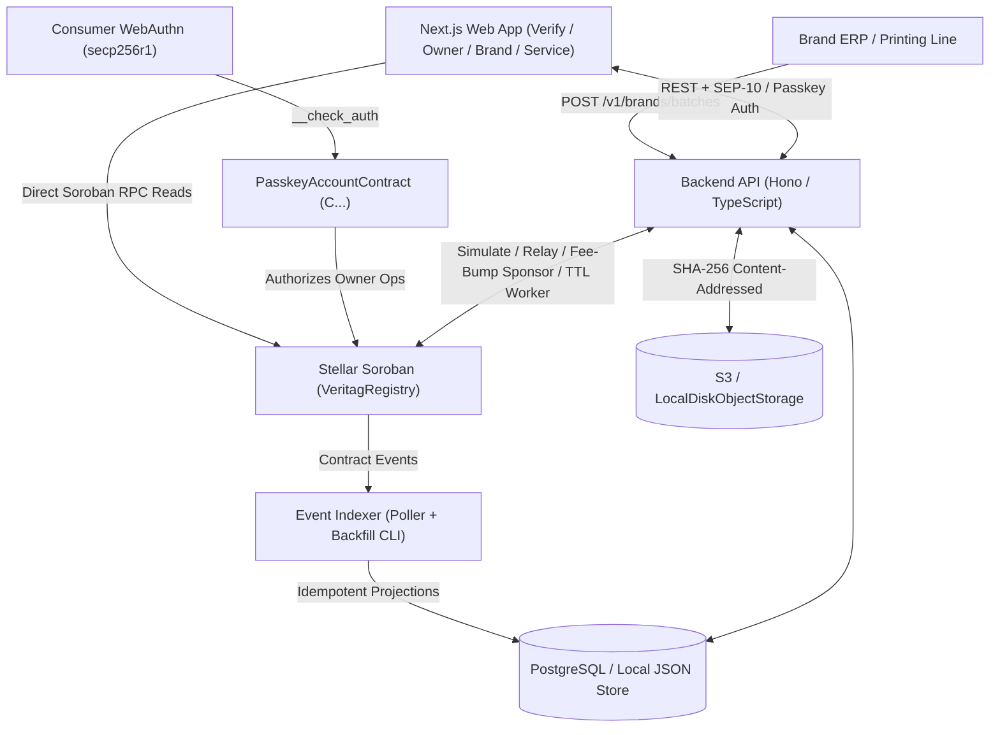

# Veritag Architecture

Veritag separates immutable cryptographic truth on **Stellar Soroban** from high-throughput indexing, print-line secret provisioning, and encrypted document storage off-chain.

## Component Topology



## On-Chain Smart Contracts (`contracts/`)

1. **`contracts/registry` (`VeritagRegistry`):**
   - Single multi-tenant authenticity and warranty registry serving all verified brands.
   - Uses **Instance** storage for `Config`, **Persistent** storage for `Brand`, `ServiceCenter`, `Batch`, `Unit`, and `Claim` (with TTLs automatically extended to cover the remaining warranty + 90-day buffer), and **Temporary** storage for expiring `TransferOffer` codes.
   - The current brand admin can temporarily suspend a batch with `freeze_batch(brand, batch_id)` and clear it with `unfreeze_batch(brand, batch_id)`, using the existing 32-byte batch identifier. Frozen batches reject activations and new warranty claims with `BatchFrozen` (25), and publish `batch_frozen` / `batch_unfrozen` events on state transitions. Warranty expiry dates stay unchanged, and a permanent recall cannot be cleared by unfreezing.
   - Batch commits accept an optional `expires_at` timestamp. The timestamp must be in the future; activation remains allowed at the exact expiry second and returns `BatchExpired` (24) afterward. `get_batch` derives `Active`, `Expired`, or `Recalled` status on each read, with recalls taking precedence. Existing stored batches are read with no expiration, and production expiration does not shorten an activated unit's warranty.
   - The originating brand admin can call `extend_warranty(brand, unit_id, additional_months)` to add deterministic 30 day months to `warranty_expiry`, even after it has lapsed. Total coverage is capped at 120 months from activation; zero months and nonoperational units are rejected. Each extension emits `warranty_extended` with `unit_id`, `added_months`, and `new_warranty_end`, and refreshes the unit TTL.
2. **`contracts/passkey-account` (`PasskeyAccountContract`):**
   - Implements Soroban `CustomAccountInterface` (`__check_auth`) verifying WebAuthn `authenticatorData` (User Present bit), base64url challenge binding in `clientDataJSON`, and `secp256r1_verify` (P-256) hardware signatures, plus optional `Recovery` signer fallback and passkey rotation (`add_passkey`, `remove_passkey`).
   - Each account starts with a sequential execution nonce of zero, exposed by `get_nonce`. Clients use the unpadded base64url encoding of `SHA256(signature_payload || nonce_be_u64)` as the WebAuthn challenge, where the nonce occupies 8 bytes in big endian order. Successful passkey and recovery authorizations advance the shared nonce; failed authorization leaves it unchanged. Replays and out of order assertions return `ChallengeMismatch`, duplicate challenge fields are rejected, and nonce exhaustion fails without wrapping.
3. **`contracts/account-factory` (`AccountFactoryContract`):**
   - Deterministically deploys `PasskeyAccountContract` instances via `env.deployer().with_current_contract(salt).deploy_v2(...)` so consumers get a predictable `C...` Soroban smart wallet address from their WebAuthn credential ID before or during first product activation.

## Identifier & Merkle Construction

All sensitive serials and secrets are hashed before touching the chain:

1. `serial_hash = sha256(serial_utf8_bytes)`
2. `secret_hash = sha256(secret_utf8_bytes)`
3. `leaf = sha256(serial_hash || secret_hash)`
4. `parent = sha256(min(left, right) || max(left, right))` (lexicographically sorted sibling pairs)
5. `unit_id = sha256(brand_address_xdr || batch_id || serial_hash)`

Sorted-pair internal hashing allows compact `Vec<BytesN<32>>` proofs without auxiliary left/right bitvectors and guarantees deterministic parity between Rust (`contracts/registry/src/merkle.rs`) and TypeScript (`packages/sdk/src/merkle.ts`).

## Event-Sourced Indexer & Backfill (`indexer/`)

Soroban RPC nodes retain historical events for a bounded retention window. The Veritag indexer:

1. Polls `getEvents` filtered by `REGISTRY_CONTRACT_ID` using persisted cursors in `indexer_state`.
2. Supports ledger-range backfill via `veritag-indexer --backfill --from <startLedger> --to <endLedger>`.
3. Decodes XDR `ScVal` topics and map payloads produced by `#[contractevent]` into typed TypeScript events.
4. Applies projections idempotently inside PostgreSQL transactions keyed by event ID (`ON CONFLICT (id) DO NOTHING`).
5. Tracks confirmation depth (`INDEXER_CONFIRMATION_LEDGERS`) before marking events `finalized = true`.

## Database Partitioning & Vacuuming Maintenance

High-volume event tables (`raw_events` and `unit_transfers`) are range-partitioned on `ledger` in **100,000-ledger** increments (`backend/src/db/schema.sql`). Always include `ledger` bounds (e.g. `WHERE ledger >= $1 AND ledger <= $2`) in analytical or finalization queries so PostgreSQL performs **partition pruning** instead of scanning all partitions.

```bash
# Apply schema & initial partitions
pnpm --filter @veritag/backend db:migrate

# Pre-create partitions for current ledger + 2 lookahead ranges (100k ledgers each)
pnpm --filter @veritag/backend exec tsx src/db/migrate.ts --ensure-partitions --ledger 300000

# Run VACUUM ANALYZE on partitioned event tables
pnpm --filter @veritag/backend exec tsx src/db/migrate.ts --vacuum
```

You can verify partition pruning in `psql` with:

```sql
EXPLAIN ANALYZE
SELECT * FROM raw_events
WHERE ledger >= 100000 AND ledger < 200000;
```
